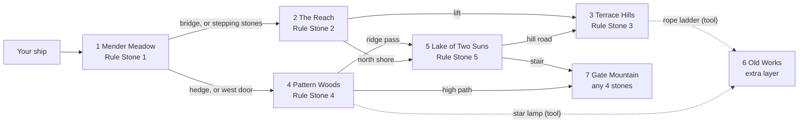

# The big world: Planet Algora, Galaxy Patternox

**Date:** 22 November 2026. **For:** Marc. **From:** the big world thread.
Everything is **[Proposal]** unless it says [Source] or [built].

**How finished is each part?**

| Part | State |
|---|---|
| The map of the whole planet, and the engine that walks it | **built**, as its own page: `docs/bigworld/index.html` |
| Region 1, the Mender Meadow | **designed in full and built** (section 4) |
| Region 2, the Reach | **built,** the second night, on Brief 2. Its own note: `GMQ_Big_World_Reach_Design_v1_2026-11-22.md` |
| Region 3, the Terrace Hills | **designed, not built.** Its own note: `GMQ_Big_World_Hills_Design_v1_2026-11-22.md` |
| Regions 4 to 7 | **outlines only** (section 5). Each needs its own design note, a full open problem, a finished example and number checks before it is built |
| Regions 8 and 9 (extra lands) | a name and a maths idea. Nothing else |

Nothing in the game was touched. A child cannot reach regions 3 to 9 yet.

**Added the second night (Brief 2):** Algora is a typed world, like the game: a child types or taps, and every thing answers every doing word. Each people's big quest lifts one ship part to Level 2. Mini quests have your lantern's shape and end in an epic card. A loose cog rolls out on the walk. Five tunes. The law of the road is in the page's check. See the report.

*The whole map, 128 squares by 96, with the mist taken off. A child sees only the part they have walked.*

**An independent reviewer read the first draft of this note** and found 16 faults. This version answers them. What changed is in section 13.

---

## 0. Your message, and how I read it

[Source: Marc, 22 November] "Do patternox. I'm going to bed. Work as long as you can. Look at what we have done. Understand the scope and sequence... See what you can do based on what we've done, the handoff, and your own creativity and logic."

- **Read as:** option A, a new final planet in Patternox. Work through the night without stopping at each phase.
- **So I did not stop after Phase 0 or Phase 1,** as the handoff says to. **That means I made choices that are yours.** They are all in section 11, with what each costs. Every one can still be changed.
- **Three questions from the handoff were not answered.** I chose what closes nothing:
  - **The Clockmaker:** not in what is built. Section 8 lays out the choice.
  - **Grade 4 extra lands:** named, not designed, not built.
  - **What the children call you:** the page never names you. It says "your teacher".

---

## 1. How big is safe? (Phase 0)

- **Test page:** `docs/bigworld/size_test.html`. An astronaut walks across maps of 100 × 100, 200 × 200 and 300 × 300 squares. The page shows the time each frame takes.
- **On this machine,** all three sizes ran at 60 frames a second on all three screens.
  - The page draws only the squares on the screen: 230 to 290 of them, whatever the size of the map.
  - The slow part is finding a path across the whole map: up to 19 thousandths of a second on the 200 × 200 map. That happens once for each tap.
- **This machine is not an iPad.** Its numbers are a first guide. **Please open the page on the old iPad** and tap "Test all three". It takes 45 seconds. A photo of the table is all I need.
- **What I chose:** 128 × 96 squares. That is about 75 iPad screens. Chronosia is one.
  - The iPad is not the limit. Filling the map is (handoff, section 4).
  - **The cost of a big map:** the Meadow took one long session with its checks. Eight more regions are about eight more.

---

## 2. The story reason

**Told before any maths, on six short pages at the start** [built]:

1. The wormhole to Galaxy Patternox is broken [Source: your site]. It flickers.
2. A small ship can slip through a flicker. A big ship cannot.
3. A call comes through: "This is the S.S. Infinity. We are lost in Patternox. The Gate's code is broken. Please help."
4. Past the wormhole is one planet with two suns.
5. Your mission: find out why the Gate broke. Mend it. Then Patternox is open to everyone.
6. You land in a green meadow.

**What is wrong on the planet:**
- Long ago the Makers built the Gate, the far end of the wormhole. They also built machines for the five peoples. **Each machine follows one rule.**
- When the Gate broke, every rule plate burnt black. The machines still run. Nobody knows what they do.
- Each people keeps one **Rule Stone**. A stone lights when its rule is used to help someone. The Gate needs the stones.

**Why the cadet can always leave:** a small ship fits through a flicker. So the planet never traps a child.

**What comes from your 2023 pages, and what I changed:**

| Your page [Source] | What I did with it [Proposal] |
|---|---|
| The Patternox wormhole is broken | Kept. It is why the cadet comes |
| "Cracking the Cosmic Code": "Welcome aboard the S.S. Infinity... Our alien spaceship is lost in the Pattern Universe... Numeric codes" | **Changed.** On your page the child is aboard the ship. Here the ship has come down on the planet, and its crew are one of the five peoples. The Gate's code is the last problem |
| "Harmony of the Twin Star System": Multiplica and Dividia; a balance between multiplication and division | **Changed.** Your page has a star system. I made one planet that circles both stars. The Twinseers keep them in step |

- **One planet from two quests is my choice, not yours.** The other way is two planets: one for each quest. See section 11, decision 2.
- **[Conflict]** Your site says the wormhole opens after "Quest 2 in the Numbers Universe". That quest was never written (world map, section 6). This design does not use that lock.

---

## 3. The regions, and how a child moves between them

| | Region | Who lives there | The maths idea | State |
|---|---|---|---|---|
| 1 | **Mender Meadow** | the Menders: small copper folk who keep the machines | Find a machine's rule. Plan with rules in order | **built** |
| 2 | **The Reach** | the Rillfolk: river people with rafts | The missing number | **built** |
| 3 | **The Terrace Hills** | the Furrows: tall farmers | Split and swap | designed |
| 4 | **The Pattern Woods** | the Eights: the crew of the S.S. Infinity | Number patterns | outline |
| 5 | **The Lake of Two Suns** | the Twinseers | Times and share undo each other | outline |
| 6 | **The Canyon and the Old Works** | nobody now | Two machines in a row | outline; an extra layer, not on the main road |
| 7 | **Gate Mountain** | the Gate | Everything together | outline |
| 8, 9 | **The Prime Isles, the Growing Dunes** | not decided | Grade 4 | names only |

### The law of the road

**No people's job is ever needed to reach another people.** [The 2023 lesson: Patternox waited on a quest that was never written.]

- Every border has two ways across. Each way is a lock at the door, opened by maths, needing nothing carried.
- **Tools never open the main road, and a tool is never one of a border's two ways.** The raft, the rope ladder and the star lamp open short cuts, extra layers and old places seen again [Source: Marc, 21 November: "go back to your previous places... get better things"].
- **Any four of the five Rule Stones open the Gate.**
- **The test of the law:** leave any one people's job undone. Every people can still be reached, and four stones can still be lit. The page's check will test this as regions are built. Today it tests the one border that exists.

### The ways across

| Border | One way | The other way | Built? |
|---|---|---|---|
| Meadow to Reach | The bridge: exactly the right pips on its pan | The old stepping stones: go on with a number pattern | **both** |
| Meadow to Woods | The hedge: a knock pattern. The birds on the wall tap it out | The wall's west door: a weighing lock with a missing number | no |
| Woods to Lake | The ridge pass. An open path | (the Reach's north shore also reaches the Lake) | no |
| Across the Lake, to the island | The Twinseers' ferry: the ferry keeper's riddle | The low-tide causeway: step out when the tide table says so | no |
| Reach to Hills | The lift: it rises on the right skip count | The hill road from the Lake's east shore | no |
| Lake to Gate Mountain | The stair from the north shore | The high path from the Woods | no |
| To the Old Works (extra) | The rope ladder, a tool from the Furrows | The lamp tunnel, with the Eights' star lamp | no |

**Why a child would collect stones from five peoples, and carry tools** (the handoff asks for a reason for anything other games do):
- **Five stones are five maths ideas.** The count on the screen tells the child, and you, which ideas are done.
- **Tools that open old places** are your own idea of 21 November.
- **More than one way to go** after the Meadow is what makes a world feel big. It also means a child stuck in one place has somewhere else to be.

---

## 4. Region 1 in full: the Mender Meadow [built]

### The trouble, told by Elder Thimble before any maths

- "The Makers built machines for us, long ago. Each machine follows one rule."
- "When the Gate broke, every rule plate burnt black. Now nobody knows the rules."
- "One machine ate some of our pips! We do not dare to use them."
- "Four machines stand in our meadow. Find each rule. Make each one a new plate."

### The job that lights Rule Stone 1: four plates

- **What the child looks at:** the machine fills the picture. A hopper, a burnt plate, an IN drum, an OUT drum, a tray.
- **What the child does:**
  - Chooses how many grey test pebbles to put in, from 1 to 20. Sees what comes out.
  - Writes a line in the notebook only by tapping "Write it down". The game never fills the table.
  - Makes the plate: taps a sign (+ − × ÷), then a number.
- **A wrong plate is shown wrong by a test:** "It drops in 5 test pebbles. Your plate says 11 will come out. Out come 15." The right rule is never said.
- **A machine that cannot follow its rule** rattles and hands the pebbles back. (Share by 2 cannot take 7. Take away 5 cannot take 3.)
- **Each child's machines:** one times (2, 3 or 5), one add (3 to 9), one take away (2 to 8), one share (2 or 3). Which one stands where is mixed for each child.
- **Finished example, the painted wall:** Elder Thimble's old water pump. 2 buckets in, 8 out. Add 6, or times 4? One test cannot tell. 3 buckets in gave 12. So times 4.
  - It is about buckets. No child's machine has × 4 or + 6. (Checked on 20,000 children.)

### The first way over the Rill: the bridge pan

- **The story:** the bridge has a lock, its pan. The Makers made it so only someone who knows the machines can bring the bridge down. It wants an exact number of pips.
- The elder gives the last pips: 3 to 8. The pan wants a number from 20 to 90.
- **The child chooses which machines, in which order.** Only machines with a true plate.
- **The child says what will come out before the machine runs.** A wrong answer: the machine does not run, and nothing is told. The game never does the sum.
  - With real pips in hand, a true machine's test tray is shut. Otherwise the tray would do the sum.
- The fewest runs is always 3. No number the pouch can hold is a dead end. (Both checked on 20,000 children.)
- "Pips are never lost. My helpers fetch them back out of the machines." So the elder has a fresh pouch at any time.
- **Finished example, the carving on the post:** 2 seeds. Times 10, then add 1: 21. Add 1, then times 10: 30. "Same machines. Another order. Another end."

### The second way: the old stepping stones

- The post has three number drums: say 3, 11, 19. Five rows of three stones follow. One stone in each row goes on with the pattern.
- **A splash sends the child back to the bank, and the river moves the stones:** the drums turn, a new pattern. So trying each stone in turn does not work. Guessing all five gets across 1 time in 243.
- **Finished example:** an old ferry rope with number tags: 2, 5, 8. Each is 3 more. So 11, 14, 17.
- **Crossing this way does not light the stone.** The stone needs the Menders' own job.

### Help for a child who is stuck [built]

[Source: your rule 1: "Nudges only when asked."]
- **A "Nudge" button** on every task. It gives a way to think, never a number. For example: "Try two numbers next to each other, like 4 and then 5. How much does OUT change?"
- Every finished example can be looked at again.
- **The mission report counts each nudge, test, wrong plate and wrong answer.** So you can see who needed help, without a dead end.
- Help with the maths is open to every child. It is never behind a secret (Secrets Balance, section 4).

### People, finds and secrets

| Who or what | Kind | What happens |
|---|---|---|
| Elder Thimble | asker, giver | The story, the plates, the pouch, the Rule Stone |
| Pim, a Mender child | asker | Lost a red spinner by the pond. Gives a clue: the stepping stones |
| The orchard keeper | greeter, then asker | "Four rows of six trees." Lost a lucky coin |
| A gardener, a fisher, a reed cutter | greeters | They say hello. Two say something new once the machines run again |
| A Mender with big ears | teller | The Rillfolk used to sing across the river. After the bridge is down: "Listen! They are singing again." |
| An old Mender | teller | "My gran crossed the Rill north of the bridge. On the old stones." |
| A Rillfolk guard (far bank) | greeter, teller | The road east is washed out. Climb the hill |
| **The hollow log** | secret | A Maker's coin. The keeper's thanks is a clue: "look in the rubble by the old wall" |
| **The rubble** | secret | A thick black shard. Elder Thimble knows it: a piece of the Gate's own plate. It goes on the Needs list "for another day": it belongs at the Gate |
| The well, the ring of flowers, the west cliff | scenery | A line each |
| The hedge in the old wall | a wall with a pointer | "Knock the way the Woods count." On the Needs list, "for another day" |
| The lookout hill (far bank) | a view | The Reach, the lake, the mountain and the Gate, far away |

- **The two secrets make a chain:** the coin, the keeper's clue, the shard, the elder's story. All of it is optional. It leads to the Gate, later.
- **Neither secret helps with a rule.** The first draft had two that did. The reviewer caught it.
- **What the child did changes the place:** the pip store fills, the Rule Stone glows, and people say new things.

---

## 5. Regions 2 to 7: outlines

**These are not designs yet.** Each line below says what the full design must still decide. I have written them so that no two peoples share a problem.

### 2. The Rillfolk: the missing number [built]

**Built the second night.** Its own note says what is built and why: `GMQ_Big_World_Reach_Design_v1_2026-11-22.md`. The lines below are the short form. (The warm-up dials named below were dropped: a reviewer showed they changed nothing.)

- **Their trouble:** every dock has a load dial: rafts × baskets on each raft = baskets. One window on each dial burnt out. The crews load wrong.
- **Warm-up:** mend three dials, which show last season's load. ? × 7 = 63. 5 × ? = 30. 3 × 6 = ?
- **The open problem that lights the stone, "the fleet":** the harbour has three kinds of raft: say 4-rafts, 6-rafts and 7-rafts, a few of each. Three towns have ordered baskets. A raft sails full. A town's rafts are all one kind. Each town gets exactly its order.
  - The maths is the missing number, many times: what times 6 makes 36? Does anything times 7?
  - The towns cannot be done one at a time. A choice that is right for one town can take the rafts another needs.
- **The first version of this problem** had too few rafts, and the child chose who went without. A reviewer showed it needed almost no Grade 3 maths, and that a kind child would fail it. Whether a town may go without is your decision 1 in the Reach's note.
- **Finished example:** the baker: 24 loaves, trays for 5 or trays for 6.
- **They give:** a raft. A tool: short cuts on the lake and the coast.

### 3. The Furrows: split and swap

**This one now has its own design note:** `GMQ_Big_World_Hills_Design_v1_2026-11-22.md`. The lines below are the first short form.

- **Their trouble:** they know only the easy facts: ones, twos, fives and tens. Their big-fact wheel burnt out. They cannot count a field of 7 rows of 8.
- **The open problem:** the picture is the field. The child fences it into parts the Furrows can count. For 7 × 8 there is more than one way:
  - by rows: 5 rows and 2 rows. 5 × 8 and 2 × 8.
  - by columns: 5, 2 and 1. 7 × 5, 7 × 2 and 7 × 1.
  - **Swap:** the Furrows know 8 × 5 only as 5 × 8. The child turns the field to show it is the same.
- **Still to decide:** how the child fences on an iPad. That the squares cannot simply be counted. Whether three parts is too many.
- **Finished example:** to be written. A quilt, not a field.
- **They give:** a rope ladder. A tool.

### 4. The Eights: number patterns

- **Their trouble:** the S.S. Infinity came down in the woods. Its course box needs the Gate's code. The log pages are torn.
- **Warm-up:** mend the log: patterns with gaps.
- **The open problem:** the captain's sayings. "4 times a number is always even." The child tests each one with numbers of their own and sorts it: always, sometimes, never.
- **Still to decide:** which sayings. How a child shows "always" without the game telling. The first draft's "two rules at once" was Grade 4 work; it is gone.
- **Finished example:** to be written. A string of beads.
- **They give:** the ship's star lamp. A tool.

### 5. The Twinseers: times and share undo each other

- **Their trouble:** the watch house keeps the two suns in step. What Multiplica grows, Dividia shares back. The dials have drifted, and the lake's tides come wrong.
- **The open problem:** not designed. The idea: Multiplica's dial is set; the child sets Dividia's to undo it, and checks by running both. 6 × 7 = 42, so 42 ÷ 7 = 6.
- **Still to decide:** almost everything: the purpose, the facts, what the child makes.
- **Finished example:** to be written.

### 6. The Old Works (an extra layer) and 7. the Gate

- **Why the Gate broke is learned on the main road:** each lit stone shows one picture of that day in the Gate's ring. Four pictures are enough.
- **The Old Works** holds the whole story, two machines in a row, and the place where the black shard fits.
- **The Gate's own problem** is not designed.

---

## 6. The maths, against the Grade 3 standards

I read each standard again. The first draft's table was too sure.

| What the child does | Standard | How sure |
|---|---|---|
| Finds a machine's rule from tests | 3.OA.9 says: find arithmetic patterns and explain them. **This is a reading.** Rule machines are common in Grade 3 books, but "make a pattern from a rule" is 4.OA.5. Your Patternox note puts number machines under 3.OA.9 | a reading |
| Says each machine's result first | 3.OA.7 (× and ÷ within 100), 3.NBT.2 (+ and − within 1,000) | sure |
| Plans three runs to the pan | 3.OA.8 asks for two-step problems. **Three steps is a stretch.** Each step is one Grade 3 sum | a stretch. See decision 9 |
| Goes on with a pattern on the stones | 3.OA.9 | sure |
| The Rillfolk's missing number | 3.OA.4 | sure |
| The Furrows' split and swap | 3.OA.5 | sure |
| The Eights' "always even" | 3.OA.9. It is the standard's own example | sure |
| The Twinseers' undoing | 3.OA.6 | sure |

- **What the game has now** [Source: `GMQ_AERO_Grade3_Map_v1_2026-11-19.md`]: 3.OA.5 has nothing. 3.OA.4 has one place, Xylophora's Solar Factory. 3.OA.9 is light.

---

## 7. Not getting lost, class time, and saving [built]

- **Map:** the whole planet. The land's shape is "your ship's landing photo". Mist covers what the child has not walked.
- **Needs:** "What I still need". The mission is always first. A line is added only when the child talked to someone or looked at something. It never says where the answer is.
- **Ship:** "Go back to my ship", the cards won here, the mission report.
- **A "!"** floats over the village when the elder has something new. Never over a secret.
- **Time:** the Meadow is built to take 30 to 40 minutes. That is a guess.
- **Saving:** after every step. Closing the page in the middle of a machine, or on a stone in the river, and opening it again puts the child back there. The test does this.
- **Each child's numbers are their own.**
- **For later, when there is more than one region:** the ship could hop to any village whose stone is lit. The cost: less walking means less finding. See decision 10.

---

## 8. Connections to other planets

[Source: Marc, 22 November: "mini-quests that connect to other planets and can result in gold cards".] None is built. None is on the main road.

| Link | From | To | What it does |
|---|---|---|---|
| The measuring tape | Lengthar [built] | The Furrows | Measure a terrace wall for a new gate |
| A light from elsewhere | Voltara's glow stone [built], or strand A's lantern | A short cave in the Woods' ridge | A short cut and a find. Algora's own star lamp opens it too |
| The star lamp | Algora | Chronosia's dark passage | Every child gets a light there |
| The square leaf print | Xylophora [built; a keepsake with no use] | The Pattern Woods | It fits a square tree |
| The notebook table | Algora | Every planet | Patternox "teaches the move", then the move travels. The main thread would wire it |

- **Which of these gives an epic card is yours to say.** Card rules are yours.
- **The rows** are in `GMQ_Big_World_Web_v1_2026-11-22.csv`. Joined to the main spreadsheet, `checks/world_web_check.py` passes.

**The Clockmaker: your choice.** Chronosia's workshop holds his ticket: "Time portal. One way." [built]

| | Option | For | Against |
|---|---|---|---|
| a | He is on Algora, by the lake | It answers the hook. He can explain gates: a time portal is a small one | It ties this planet to a find most children may not have seen |
| b | He is not here | Nothing to build | The hook stays open |
| c | He is why the Gate broke | A person, not a storm | It makes your character the cause |

---

## 9. The AI's place

[Source: CLAUDE.md: "the constraint architecture is the foundation".]

- **The world is data with a checker.** Regions, things, beings, finds, gates, borders, jobs and items are tables in the page. A check reads them every time the page opens, and lists every fault.
- **It fails if:** a thing cannot be reached; a region that is not built can be; a border has one way, or two ways with the same maths; a main job needs a secret; a secret holds maths help for a main job; a find leads nowhere and is not scenery; a job waits on a region that is not built.
- **To be sure it can fail,** ten broken copies of the world are fed to it. It catches each one.
- **So an AI can add a greeter, a find or a place as one line of data.** The numbers stay in code.
- **The page can give an AI the facts of where the child stands,** ending with what must never be said: any machine's rule, the number that will come out, which stone is next.
- **No AI answers a child yet.** People speak from short lists of lines.

---

## 10. What could prove this wrong

**About the Meadow**
- **The old iPad.** The size test has only run here.
- **Four machines may be too many,** or too alike. Watch a child at the third.
- **Children may guess plates.** Each wrong plate is shown wrong by a test, which also gives the child one more test for free. So guessing is slow, but it works. The report counts tests and tries. See decision 8.
- **The pouch may be too hard.** Three runs, each said first. The stepping stones are the other way, the elder resets the pouch, and there are nudges.
- **Or it may be stumbled through:** adding and taking away, machine by machine, until the number comes. Every step is still a sum the child said first.
- **The stepping stones may be easier than the bridge.** Then everyone takes them.
- **A splash wipes the whole pattern.** A child four stones across loses it all. That is the price of stopping guessing.
- **"Hands them back"** may read as "the rule is: nothing changes". The words say "It cannot follow its rule with 3".
- **Words that may need you,** above all for children still learning English: hopper, rattles, pips, exactly, pebbles, plate.
- **Typing is on since the second night.** The game's doing words, and small letter keys on the desk. Watch whether children type at all, or only tap.

**About the whole planet**
- **Walking.** 75 screens is a long way on foot once several regions exist.
- **A map of places you cannot go.** The big map shows the dark shape of eight regions on the first day. That may thrill, or annoy.
- **A child may reach the Gate with three stones.** The Gate must say which peoples still wait.
- **iPads can clear a page's saved game** if the page is not opened for some days. The game has the same risk. A save on your server is the real cure.
- **Filling it.** Eight more regions at the Meadow's depth is weeks, as the main thread said.
- **Nobody has played it.** No child, and not you. Every time above is a guess.

---

## 11. Your decisions

**Choices I made tonight that are yours.** Each can be changed.

| | What I chose | The other way | What changing it costs |
|---|---|---|---|
| 1 | The planet is "Algora" | Any name of yours | One line |
| 2 | **One planet from your two Patternox quests** | Two planets: the S.S. Infinity's, and the twin stars' | A second map. The engine is shared |
| 3 | **Five peoples, and "the Makers" who built the machines** | Fewer peoples; no Makers | The Meadow's words. Its maths stays |
| 4 | The peoples' names: Menders, Rillfolk, Furrows, Eights, Twinseers | Yours | A few lines each. (My first name for the Menders was one letter away from a character in a famous game. Changed.) |
| 5 | 128 × 96 squares | Bigger or smaller | Bigger is free now. Smaller means painting the map again |
| 6 | Any four stones open the Gate | All five | One line. All five brings back the hard chain |

**Choices not made yet.**

| | Decision | Options, with costs | I would choose |
|---|---|---|---|
| 7 | Why the Gate broke | (a) a storm: nobody's fault, but no story. (b) The S.S. Infinity was too big for it: ties your ship to your wormhole; the crew carry some blame. (c) Someone used a wrong code: a culprit; a harder story to tell kindly | b |
| 8 | Should a wrong plate cost something? | No (now): guessing is slow but free. A wait: fair, but dull. Fewer tries: can lock a child out | no, until children have played |
| 9 | The pan: three runs, or two? | Three (now): past the standard's two steps; a real plan. Two: inside the standard; over quickly | three, and watch |
| 10 | Ship hops between villages | Yes: lessons are short. No: walking is how things are found | yes, only to villages whose stone is lit |
| 11 | How extra lands open | The teacher's switch: your class, your call. A clean run of a job: shuts out children who needed tries. A quest: more to build | the teacher's switch, and a quest |
| 12 | The Clockmaker | section 8: a, b or c | a |
| 13 | Which region next | The Reach: the design is furthest on. The Woods: your S.S. Infinity | the Reach |
| 14 | Surprises on the walk [Source: Marc, 18 November: "suddenly something pops up"] | None (now). Something that fits Algora: a loose machine part that rolls away and must be caught with three quick sums. Not a creature in tall grass: that is another game's idea | after you have seen the walk |
| 15 | Permission to put `docs/bigworld/` on the site | One line from you | |

---

## 12. What ran, and what did not

See `GMQ_Big_World_Report_2026-11-22.md` for the results.

- **Ran:** the number check (20,000 children), the map check, the play test (three screens, taps only), the size test, the world web check on the joined spreadsheet.
- **Did not run:** the game's own tests. This thread changed nothing of the game's.
- **Not done:** no child has played it. The old iPad has not opened it. No AI is wired in. Sound is a few beeps.

---

## 13. What the reviewer found, and what changed

| The reviewer's fault | What I did |
|---|---|
| **The raft was a hard chain.** The Lake could only be reached with the Rillfolk's raft | New law of the road (section 3). Tools never open the main road. The Lake has a ferry and two shores |
| Two ways with the same maths (Reach to Hills) | The lift is now a skip count; the other way is a road |
| The chart and the table disagreed | One table, one chart, drawn from it |
| Regions 2 to 7 read as worksheets with a one-line open problem | Called what they are: outlines. Each says what is still to decide |
| Finished examples missing for regions 2 to 7 | Marked "to be written". Not hidden |
| Two peoples shared one problem | Rillfolk: the missing number. Twinseers: undoing. Different numbers |
| The test tray did the child's sum | **Fixed in the page:** shut on a true machine while real pips are in hand |
| "Ate half our pips" gave a rule away | **Fixed:** "ate some of our pips" |
| Both secrets helped with a main job | **Fixed:** the secrets are now a chain to the Gate. Neither helps with a rule. The check now fails if one does |
| "48 baskets" was not open; the field split was unproven | A new open problem (the three towns). The field's splits are listed |
| Decisions made for you | Section 11 now lists them first, with costs |
| Standards claimed too surely | Section 6 |
| No help for a stuck child | **Built:** nudges, when asked, counted in the report |
| Risks missing | Added to section 10 |
| Source tags wrong | Fixed in section 2 |
| A name one letter from a famous game's character; tall-grass surprises | Renamed to Menders. The surprise idea changed |
| No reason for the pan's number; "last pips" but a fresh pouch; carved numbers that change; an example about river stones again | **Fixed in the page:** the pan is a lock; pips are fetched back; the post has drums that turn; the example is a rope with tags |
| "Stones" meant three things | Grey test pebbles; stepping stones; Rule Stones |

**Not changed, and why:**
- **A wrong plate still gives one free test.** Showing a rule wrong by a test is the lesson: a rule must work for every number. Decision 8 is yours.
- **A splash still wipes the pattern.** Otherwise the stones can be crossed by trying each one.
