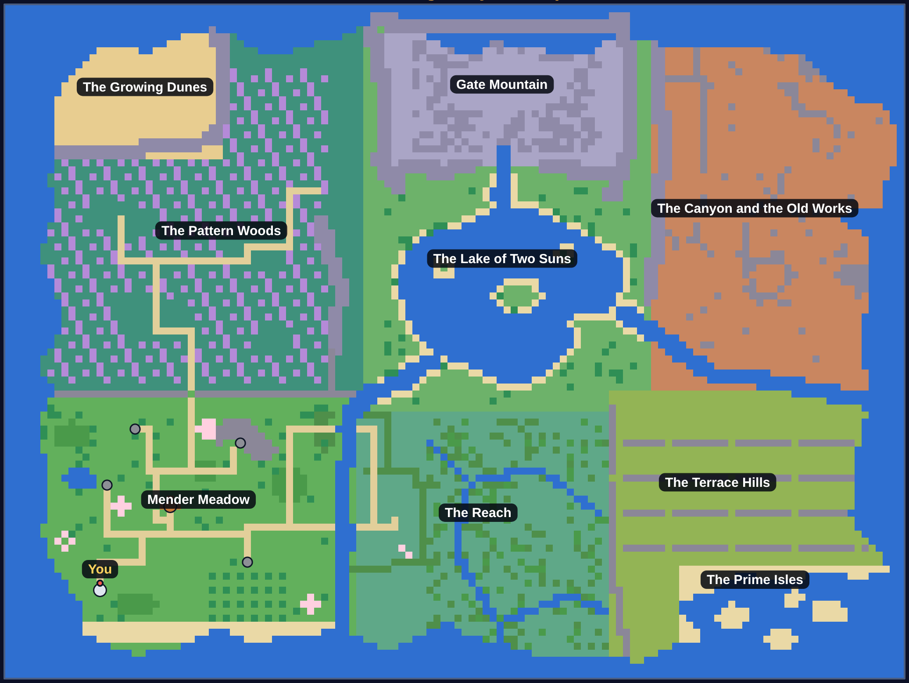
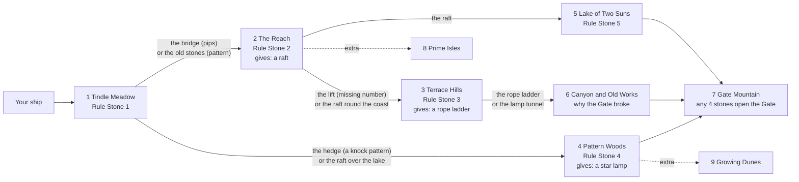

# The big world: Planet Algora, Galaxy Patternox

**Date:** 22 November 2026. **For:** Marc. **From:** the big world thread.
Everything is **[Proposal]** unless it says [Source] or [built].

**What is built:** the map of the whole planet, the engine that walks it, and the first region (the Tindle Meadow). It is its own page: `docs/bigworld/index.html`. Nothing in the game was touched.
**What is not built:** the other eight regions. They are painted on the map and written here. A child cannot reach them yet.

*The whole map, 128 squares by 96. A child sees only the part they have walked. The rest is mist.*

---

## 0. Your message, and how I read it

[Source: Marc, 22 November] "Do patternox. I'm going to bed. Work as long as you can. Look at what we have done. Understand the scope and sequence... See what you can do based on what we've done, the handoff, and your own creativity and logic."

- **Read as:** option A, a new final planet in Patternox. Work through the night without stopping at each phase.
- **So I did not stop after Phase 0 or Phase 1.** The handoff says to stop and report at each. You said to keep going. I kept every choice that is yours easy to change, and listed them in section 11.
- **Three questions from the handoff were not answered.** I chose the answer that closes nothing:
  - **The Clockmaker:** not in what is built. Section 8 lays out the choice.
  - **Grade 4 extra lands:** designed, not built.
  - **What the children call you:** the page never names you. It says "your teacher".

---

## 1. How big is safe? (Phase 0)

- **Test page:** `docs/bigworld/size_test.html`. It walks an astronaut across maps of 100 × 100, 200 × 200 and 300 × 300 squares and shows the time for each frame.
- **On this machine,** all three sizes ran at 60 frames a second on all three screens. Drawing took under half a millisecond.
  - The page draws only the squares on the screen: about 230 to 290 squares, whatever the size of the map. So the size of the map hardly matters for drawing.
  - The slow part is finding a path across the whole map: up to 19 ms on a 200 × 200 map. That happens once for each tap, not every frame.
- **This machine is not an iPad.** Its numbers are a first guide. **Please open the page on the old iPad** and tap "Test all three". It takes 45 seconds. Send me a photo of the table.
- **What I chose:** 128 × 96 squares. That is about 75 iPad screens. Chronosia is one screen.
  - **Why not bigger:** the iPad is not the limit. Filling it is. Each region needs a story, a problem, a finished example, checked numbers and checked pictures (handoff, section 4). Nine regions on 128 × 96 keep every walk between two things short.
  - The map can grow later without breaking saves, if it grows to the east or south.

---

## 2. The story reason

**Told before any maths, on six short pages at the start** [built]:

1. The wormhole to Galaxy Patternox is broken [Source: your site]. It flickers.
2. A small ship can slip through a flicker. A big ship cannot.
3. A call comes through: "This is the S.S. Infinity [Source: your Quest 1]. We are lost in Patternox. The Gate's code is broken. Please help."
4. Past the wormhole is one planet with two suns [Source: your Quest 2: the twin stars Multiplica and Dividia].
5. Your mission: find out why the Gate broke. Mend it. Then Patternox is open to everyone.
6. You land in a green meadow.

**What is wrong on the planet:**
- Long ago the Makers built the Gate, the far end of the wormhole. They also built machines for the five peoples. **Each machine follows one rule.**
- When the Gate broke, every rule plate burnt black. The machines still run. Nobody knows what they do.
- Each people keeps one **Rule Stone**. A stone lights when its rule is used to help someone. The Gate needs the stones.

**What the cadet fixes:** each people's trouble, with that people's kind of rule. Each one lights a stone. Then the Gate.

**Why the cadet can always leave:** a small ship fits through a flicker. So the planet never traps a child, and the game's other planets stay open. Mending the Gate is for the big ships and for everyone else.

**Your two 2023 quest pages become the planet:**

| Your page [Source] | Where it lives |
|---|---|
| "Cracking the Cosmic Code": the S.S. Infinity, lost; number codes guide it home | The crew are one of the five peoples. The Gate's code is the last problem. |
| "Harmony of the Twin Star System": Multiplica and Dividia must stay in balance | The planet's two suns. The Twinseers on the lake keep them in step. |

**[Conflict]** Your site says the wormhole opens after "Quest 2 in the Numbers Universe". That quest was never written (world map, section 6). This design does not use that lock. The key is on the planet itself.

---

## 3. The regions

| | Region | What it looks like | Who lives there | The maths | Built? |
|---|---|---|---|---|---|
| 1 | **Tindle Meadow** | Green meadow, a pond, an orchard, the Makers' old wall | the Tindles: small copper folk who keep the machines | Find a machine's rule (3.OA.9). Plan with rules in order (3.OA.8) | **yes** |
| 2 | **The Reach** | Reeds, channels, houses on legs | the Rillfolk: river people with rafts | The missing number (3.OA.4, 3.OA.6) | landing only |
| 3 | **The Terrace Hills** | Fields in steps | the Furrows: tall farmers | Split and swap (3.OA.5) | no |
| 4 | **The Pattern Woods** | Trees planted in number patterns | the Eights: the crew of the S.S. Infinity | Number patterns and codes (3.OA.9) | no |
| 5 | **The Lake of Two Suns** | A lake, gold on one side, blue on the other; islands | the Twinseers | Times and share undo each other (3.OA.6, 3.OA.7) | no |
| 6 | **The Canyon and the Old Works** | Red rock, the Makers' ruins | nobody now | Two machines in a row (3.OA.8) | no |
| 7 | **Gate Mountain** | A high flat of stone, and the Gate | the Gate | Everything together | no |
| 8 | **The Prime Isles** (extra) | Sand islands in a bay | to be decided | Grade 4: factor pairs, primes (4.OA.4) | no |
| 9 | **The Growing Dunes** (extra) | Dunes like steps | to be decided | Grade 4: patterns that grow (4.OA.5) | no |

- **The three Grade 3 standards with nothing in the game** (3.OA.4, 3.OA.5) or little (3.OA.9) each get a region of their own.
- **Every name is new** or yours: Algora, Tindle, Rillfolk, Furrow, Eights, Twinseer, the Rill. Change any of them in one place.
- **Why "the Eights":** an 8 lying on its side is the sign for infinity. The crew of the S.S. Infinity look like a figure 8.

### The main road

- **Any four of the five stones open the Gate.** So one missing link never strands a child (the 2023 lesson). The fifth stone lights the whole ring: an epic card.
- **After the Reach the road forks.** A child chooses: Hills, Woods or Lake. That is the "huge world" feeling: more than one way to go.

---

## 4. The peoples, their problems, and the finished examples

Each problem is **open**: a purpose, bare facts, no steps (your rule 1). Each has a finished example first, about something else (your rule 3).

### 1. The Tindles: find the rule [built]

- **Their trouble:** four machines, four burnt plates. One machine "ate half our pips". They do not dare to use them.
- **The job (Rule Stone 1):** find each machine's rule and make it a new plate.
  - The child chooses how many grey test stones to put in, and sees what comes out.
  - The child writes a line in the notebook only by tapping "Write it down". The game never fills the table.
  - To make the plate: tap a sign (+ − × ÷), then a number.
  - **A wrong plate is shown wrong by a test,** not just called wrong: "It drops in 5 test stones. Your plate says 11 will come out. Out come 15." The right rule is never said.
- **Finished example (the painted wall):** Elder Rivet's old water pump. 2 buckets in, 8 out. Is it add 6, or times 4? One test cannot tell. 3 buckets in gave 12, so times 4.
  - It is about buckets, with × 4 and + 6. No child's machine has those rules.
- **The bridge (the gate to the Reach):** the elder gives the last pips, 3 to 8 of them. The bridge pan wants exactly a number from 20 to 90.
  - Machines with a true plate can change the pips. The child chooses which machines, in which order.
  - **The child says what will come out before the machine runs.** A wrong guess: the machine does not run, and nothing is told. So the game never does the sum.
  - A machine that cannot follow its rule (7 pips shared by 2) rattles and hands the pips back.
  - The fewest runs is always 3. The elder gives a fresh pouch at any time.
- **Finished example (the carving on the post):** 2 seeds. Times 10, then add 1: 21. Add 1, then times 10: 30. "Same machines. Another order. Another end."

### 2. The Rillfolk: the missing number

- **Their trouble:** every dock has a load dial: rafts × baskets on each = baskets. One window on each dial burnt out. Rafts go out too heavy and sink, or half empty.
- **The job (Rule Stone 2):** mend each dial: 6 × ? = 42. ? ÷ 7 = 6. The picture is the dock: rafts and baskets the child can count.
- **The open problem:** the harvest fleet. 48 baskets must go in equal rafts. A raft rides steady with 5 to 9 baskets. Which fleets work? More than one does. The child's fleet is the one that sails, and the far village gets what it carries.
- **Finished example:** loaves on trays in the Rillfolk bakery, with other numbers.
- **They give:** a raft. It opens the lake, the coast and the islands.

### 3. The Furrows: split and swap

- **Their trouble:** they know only the easy facts: ones, twos, fives and tens. Their big-fact wheel burnt out. A field of 7 rows of 8 is too big for them to count.
- **The job (Rule Stone 3):** the picture is the field. The child puts a fence across it: 7 × 8 becomes 5 × 8 and 2 × 8. Two fields the Furrows can count.
  - **Swap:** the path up the hill is narrow. A load 8 wide will not pass. Turned, it is 3 wide: 3 × 8 is 8 × 3.
- **The open problem:** plan the harvest of a field no Furrow can count, in parts they can. More than one split is right.
- **Finished example:** a quilt of squares, split in two.
- **They give:** a rope ladder. It goes down the canyon cliff, and up to ledges in places already seen.

### 4. The Eights: number patterns and codes

- **Their trouble:** the S.S. Infinity came down in the woods. Its course box needs the Gate's code. The log pages are torn.
- **The job (Rule Stone 4):** mend the log: patterns with gaps. Then test what is always true: "4 times a number is always even". The child tries numbers and sorts each saying: always, sometimes, never.
- **The open problem:** the course through the trees. The Makers planted the woods as a number chart. The safe way steps only on trees that keep two rules at once.
- **Finished example:** a string of beads with a rule, in the captain's cabin.
- **They give:** the ship's star lamp. It lights caves here, and dark places on other planets.

### 5. The Twinseers: times and share undo each other

- **Their trouble:** the watch house keeps the two suns in step. What Multiplica grows, Dividia shares back. The dials have drifted, and the lake's tides come at the wrong times.
- **The job (Rule Stone 5):** set each pair of dials so they undo each other: 6 × 7 = 42 and 42 ÷ 7 = 6. Then both dials must show the same: 3 × 8 = 48 ÷ ?
- **The open problem:** the tide table for one day.
- **Finished example:** a see-saw with sacks.

### 6. The Old Works, and 7. the Gate

- **The Old Works:** where the plates were made. Two machines in a row. Here the child learns why the Gate broke (your decision 3, section 11).
- **The Gate:** set the stones in the ring in an order that makes the Gate's number. It is the bridge pan again, grown up: the child's own rules, the child's own order.
- Then the wormhole holds steady. The S.S. Infinity goes home. Patternox is open.

---

## 5. The gates, each with two ways

[Source: Marc, 22 November: "or you can do different quests to get those."]

| Gate | First way | Second way | Built? |
|---|---|---|---|
| The Rill (Meadow to Reach) | The bridge: exactly the right pips on the pan | The old stepping stones: go on with a number pattern | **both** |
| Reach to Hills | The lift: a missing number makes the two sides weigh the same | The raft, round the coast | no |
| Meadow to Woods | The hedge: "knock the way the Woods count" (a skip-counting knock) | The raft, over the lake | no |
| To the Canyon | The rope ladder, from the Hills | The lamp tunnel, from the lake shore | no |
| To Gate Mountain | The stair from the lake's north shore | The high path from the Woods | no |

- **The two ways are different maths,** not an easy copy of the hard one. The page's own check fails if a border's two ways are the same maths.
- **The second way gets a child across. It does not light the stone.** The stone needs the people's own job.
- **The stones in the built gate:** three numbers are cut in the post (3, 11, 19). Five rows of three stones. One stone in each row goes on with the pattern.
  - After a splash, the river moves the stones: a new pattern. So a child cannot cross by trying each stone. Guessing gets across 1 time in 243.
  - Finished example: another river, long ago: 2, 5, 8, then 11, 14, 17.
- **Extra lands open by mastery, and never block the road** (handoff, rule 1). See section 11, decision 5.

---

## 6. People, finds and secrets in the Meadow [built]

| Who or what | Kind | What happens |
|---|---|---|
| Elder Rivet | asker, giver | The story, the plates job, the pouch, the Rule Stone |
| Pim, a Tindle child | asker | Lost a red spinner by the pond. Gives a clue: the old stones |
| The orchard keeper | greeter, then asker | Counts his trees: "four rows of six". Lost a lucky coin |
| A gardener, a fisher | greeters | They say hello |
| A Tindle with big ears | teller | The Rillfolk used to sing across the river |
| An old Tindle | teller | "My gran crossed up north, on the old stones" |
| A Rillfolk guard (far bank) | greeter, teller | The road east is washed out. Climb the hill |
| The hollow log | **secret** | A Maker's coin. The keeper tells a fact about the Orchard Machine: it gives back more, or less |
| The rubble by the wall | **secret** | Half a burnt plate. It shows ÷ and names which machine shares |
| The well, the ring of flowers, the west cliff | scenery | A line each. The cliff shows the far dunes |
| The hedge in the old wall | a wall with a pointer | "Knock the way the Woods count." It goes on the Needs list, "for another day" |
| The lookout hill (far bank) | a view | The rest of the planet, far away: the Reach, the lake, the mountain, the Gate |

- **No main job needs a secret.** The page's check fails if one does.
- **Two secrets for three tasks.** Both help with a job; neither is only a card (Secrets Balance, rules 2 and 3).
- **Each secret has a pointer:** the keeper speaks of "something hollow"; the Wall Machine's first look says "bits of stone and metal lie along the old wall".
- **Some people just say hello** [Source: Marc, 21 November].

---

## 7. Not getting lost, class time, and saving [built]

- **The map button:** the whole planet. The land's shape is "your ship's landing photo". Mist covers what the child has not walked. So from the first minute a child sees how much there is.
- **The Needs button:** "What I still need". The mission is always first. A line is added only when the child talked to someone or looked at something. It never says where the answer is.
- **The Ship button:** "Go back to my ship", the cards won here, and the mission report for you.
- **Mist** lifts as the child walks, five squares around.
- **A "!"** floats over the village when the elder has something new. Never over a secret.
- **Time:** the Meadow is built to take 30 to 40 minutes: four machines, the walk between them, the pouch. The stones and the small quests are more.
- **Saving:** after every step. Closing the page in the middle of a machine, or on a stone in the river, and opening it again puts the child back there, with the notebook as it was. The test does this.
- **Each child's numbers are their own:** which machine has which rule, the pips, the pan's number, the stones.

---

## 8. Connections to other planets (mini quests, epic cards)

[Source: Marc, 22 November: "mini-quests that connect to other planets and can result in gold cards".] None is built. Each one works without the other planet for the main road.

| Link | From | To | What it does |
|---|---|---|---|
| The measuring tape | Lengthar [built, version 86] | The Furrows | Measure a terrace wall for a new gate. An epic card |
| A light from elsewhere | Voltara's glow stone [built], or strand A's lantern | A short cave in the Woods' ridge | A short cut and a find. Algora's own star lamp opens it too |
| The star lamp | Algora | Chronosia's dark passage | Every child gets a light, even without the glow stone |
| The square leaf print | Xylophora [built, a keepsake with no use] | The Pattern Woods | It fits a square tree. A find |
| The Clockmaker | Chronosia's ticket: "Time portal. One way." [built, version 87] | A hut on the lake's north shore | **Your decision.** See below |
| The notebook table | Algora | Every planet | Patternox "teaches the move", then the move travels (Patternox note). The main thread would wire it |

**The Clockmaker: your choice.**

| | Option | For | Against |
|---|---|---|---|
| a | He is on Algora, by the lake. He came by the time portal and cannot go back | It answers Chronosia's hook. He can explain gates: a time portal is a small one. A mini quest carries his letter home | It ties this planet's story to a find most children may not have seen |
| b | He is not here. The ticket stays a mystery | Nothing to build | The hook stays open |
| c | He is why the Gate broke: he used it with a wrong code | A strong story: a person, not a storm | It makes one of your characters the cause. That is yours to say |

I would choose **a**, and keep the cause of the break separate (decision 3).

**The spreadsheet rows** for all of this are in `GMQ_Big_World_Web_v1_2026-11-22.csv`. With the main spreadsheet, `checks/world_web_check.py` passes. The main thread merges them.

---

## 9. The AI's place

[Source: CLAUDE.md: "the constraint architecture is the foundation".]

- **The world is data with a checker.** In the page, between the marks WORLD-BEGIN and WORLD-END: regions, things, beings, finds, gates, borders, jobs, items.
- **`bwCheck()` reads it and lists every fault.** It runs each time the page opens, and in the tests. It fails if:
  - a thing cannot be reached, or a region that is not built can be
  - a border on the main road has one way, or two ways with the same maths
  - a main job needs a secret
  - a find leads nowhere and is not marked scenery
  - a job waits on a region that is not built
- **So an AI can add a greeter, a find or a place** as one line of data, and the code says at once if a rule broke. The numbers stay in code: NUM-BEGIN to NUM-END.
- **`bwSlice()`** gives the facts an AI may be told about where the child stands: the place, who is near, what is carried, what is needed. It ends with what must never be said: any machine's rule, the number that will come out, which stone is next.
- **No AI answers a child yet.** Greeters speak from a short list of lines.

---

## 10. What could prove this wrong

- **The old iPad.** The size test has only run here. If the old iPad draws slowly, the squares get bigger or the outlines simpler. Ask for the photo first.
- **Four machines may be too many,** or too alike. Watch a child at the third one. If they sigh, two machines could come with half a plate already.
- **Children may guess plates** and not test. Each wrong plate is shown wrong by a test, so guessing is slow but it does work. The report counts tests and tries for each machine. If most children test once and guess three times, the plate needs a cost.
- **The test stones do sums up to 20.** A child with 7 real pips at the × 3 machine can put 7 test stones in and read 21. It is a tool they must think to use, and it stops at 20. If it becomes the habit, test stones could be locked while real pips are in hand.
- **The pouch may be too hard** for some. Three runs, each said first, with a rule that can refuse. The stones are the other way across, and the elder resets the pouch. If many children give up at the pan, the pan could accept a 2-run number.
- **Or too easy to stumble through:** a child can walk between machines adding and taking away until the number comes. That is slow, and every step is still a sum they said first. The report shows the runs used.
- **The stones may be easier than the bridge.** Then everyone takes the stones. They do not light the stone, but watch which way children choose.
- **Reading.** Every page is one or two short sentences, with "Read to me". Words that may need you: hopper, rattles, pips, exactly.
- **A machine that "hands them back"** may read as "the rule is: nothing changes". The words say "It cannot follow its rule with 3". Check that children read it that way.
- **Typing is off on this page.** Every command is a tap. The iPad's own keyboard would push the picture up. The game solved that with its own letter keys; this page has not copied them yet.
- **Nobody has played it.** No child, and not you. Every time above is a guess.

---

## 11. Your decisions

Each is easy to change now.

| | Decision | Options | I would choose |
|---|---|---|---|
| 1 | The planet's name | Algora; or yours | Yours, if you have one. It is one line |
| 2 | The peoples' names | Tindles, Rillfolk, Furrows, Eights, Twinseers; or yours | |
| 3 | **Why the Gate broke** | (a) a storm, nobody's fault; (b) the S.S. Infinity was too big for it; (c) someone used a wrong code | b: it ties your lost ship to the broken wormhole, and nobody is a villain. The station story's "one cosmic storm" (waiting on you) could also be the cause: then a |
| 4 | The Clockmaker | section 8: a, b or c | a |
| 5 | How extra lands open | (a) the teacher's switch; (b) a clean run of a region's job; (c) a quest | a and c together. b shuts out children who needed tries |
| 6 | How many stones open the Gate | 4 of 5; or all 5 | 4 of 5 |
| 7 | Which region next | the Reach (the raft opens the map); the Woods (your S.S. Infinity) | the Reach |
| 8 | Should a wrong plate cost something? | no (now); a wait; fewer tries | no, until children have played |
| 9 | The second way: should it light the stone too? | no (now); yes | no |
| 10 | Surprises on the walk | none yet; a creature in the tall grass with three quick questions (your mud rats, 18 November) | build it after you have seen the walk |
| 11 | Permission to put `docs/bigworld/` on the site | one line from you | |

---

## 12. What ran, and what did not

- **Ran:** `checks/bigworld_numbers_check.js` (20,000 children), `checks/bigworld_map_check.js`, `checks/bigworld_play_test.js` (three screens, taps only), `checks/bigworld_size_test.js`. The results are in `GMQ_Big_World_Report_2026-11-22.md`.
- **Did not run:** the game's own tests. This thread changed nothing of the game's.
- **Not done:** no child has played it. The old iPad has not opened it. No AI is wired in. Sound is a few beeps; there is no music.
