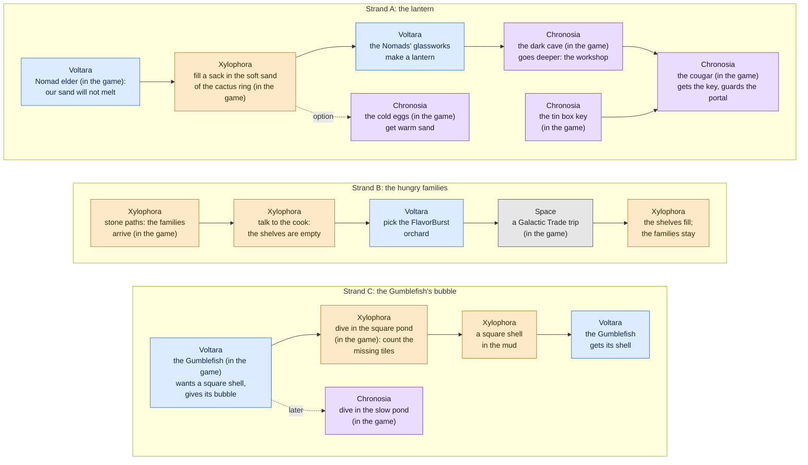

# The world web: how everything locks together

**Date:** 21 November 2026. **For:** Marc. **Nothing in this note is built.** Everything is **[Proposal]** unless it says [Source] or [built].
**The spreadsheet** that goes with it: `GMQ_World_Web_v1_2026-11-21.csv`. It has one row for every item, find and person: where it is, the maths to get it, and where it is used. Open it in Google Sheets or Excel.

[Source: Marc, 2026-11-21] "Right now you're just making these secrets that they're just secrets. But I think everything you find should possibly be able to solve a problem or a mini quest... You talk to some people nothing happens. They just say hi. You talk to some people and they give you a quest... Maybe whatever is hidden in the center of the desert connects to something that is needed on another planet. Maybe you can't explore the cave on Chronosia until you get a special torch... as a quest prize on another planet. Then can you go back to your previous places and go explore those caves, maybe get better things or answers to other questions? That would require you creating like a giant flow chart or a spreadsheet... so any new quest does appear on one planet potentially that can impact 2 other planets maybe."

**Your question:** "No new planets in the latest update?" **True.** Versions 67 to 83 changed the station, Voltara, Chronosia, Xylophora and the mission ship. Lengthar is designed but not built. Patternox waits on your choice.

---

## Built since: version 87 (22 November)

Chronosia's part of strand A is built, in a smaller form. See `GMQ_Chronosia_Links_v1_2026-11-22.md`.
- **The deep cave is one passage and one gear door,** not three chambers. It leads to the Clockmaker's workshop.
- **Its light comes from another planet** [Source: Marc, 2026-11-21, the special torch]. Today that is Voltara's glow stone. The lantern from this strand will light it too, for every child.
- **The clockmaker's key** comes from the tin box. The wound cougar takes it and guards the time portal.
- **The slow pond's dive** comes from the cold tortoise, not from the bubble. The bubble keeps Xylophora's square pond (strand C).
- The spreadsheet has the new rows. `checks/world_web_check.py` passes.

## 1. What the game has now

I checked every item and person in the game's code (version 83).

- **Since version 84 (later the same night):** no secret is needed to launch. See `GMQ_Secrets_Balance_v1_2026-11-21.md`.
- **Items:** the bag has 10 kinds of item. **Each one is used only on the planet where it is found.** The wrench, magnet, key card, star chart, oil can and fuse stay on the station. The FlavorBurst, glow stone and crystal key stay on Voltara.
- **Chronosia, Xylophora and the mission ship give no items at all.** Every find there ends in a card.
- **Some loose ends already invite.** They are the best places to tie the web, because the words are already there:
  - The tin box: "a tiny brass key, with a gear. 'Clockmaker' is scratched on it." The key opens nothing, and the child does not even keep it.
  - The big nest: "The eggs are cold. They need warm sand." No sand is ever brought.
  - The dark cave asks one sum, then shows a map.
  - The soft sand in the middle of the cactus ring.
  - The Gumblefish "giggles and blows a bubble".
  - The Nomad elder: "We have light, and we have mended one of your panels." Tiny people who can make things.
- **The badge** from the old chest is only worn.
- **People: 18 people and creatures can be talked to, and nearly all of them give a job at once.** Only the butterfly gives a tip, the giant sleeps, and the robot is silent until you fix it.
  - So the game has the opposite of the fault you describe. Nobody just says hello, and nobody has a need you only learn by asking.
  - The world feels like a list of jobs, not a place with people in it.

---

## 2. The laws of the web

1. **Every find has a use somewhere.** It is a tool, a thing someone needs, or a fact that answers a question. A card is a bonus, never the only point.
2. **A new quest touches up to two other places.** It needs one thing from somewhere else, or gives one thing that is used somewhere else, or both. [Source: your "impact 2 other planets"]
3. **People have four kinds of job.** Most are a mix:
   - **Greeters** say hello and make the place feel lived in. Some say something about the place and nothing more.
   - **Askers** have a need you only learn by talking to them [Source: your words].
   - **Givers** hand over a tool or a fact once they are helped.
   - **Tellers** pass on news from other planets: "I hear the eggs on Chronosia are cold." This is how a child learns that one place needs another.
4. **Tools open new layers in old places.** A light opens dark places. A way to breathe opens water. Going back is rewarded with better things and with answers [Source: your torch idea].
5. **The maths is in every step.** Getting a thing takes maths, and using it takes maths.
6. **No wall without a pointer.** A dark cave says "Too dark to go further. A light would help." It hooks a quest; it is not a dead end.
7. **The web adds layers. It never locks a planet's own jobs.**
   - No chain may wait on a place that is not built.
   - No planet's job list may wait on another planet.
   - That is the 2023 lesson: Patternox waited on a Numerix quest that was never written, and the Data quest waited on Patternox.

**Law 7 is kept by code, not by memory.** The spreadsheet becomes one table in the game. A check reads it every time:
- every need has a source a child can reach without that need
- every find has a use, or is marked a keepsake
- nothing waits on a place that is not built
- nothing goes round in a circle

**A first version of that check already runs on the spreadsheet:** `checks/world_web_check.py`.
- On the plan in this note, every law holds.
- To be sure it can fail, I fed it a broken copy: a loop, a Chronosia job that waits on Voltara, a need on Lengthar, a need that does not exist, and a new find nobody uses. It caught all five and failed.
- It also counts the gap you named (section 4, the end).

---

## 3. The flow chart

Three strands, one row each. **The colour is the planet.** A box marked "(in the game)" exists today; everything else is new. Dotted lines are an option or a later layer. GitHub draws this chart when you open the file there. A picture of it is beside this note: `GMQ_World_Web_v1_2026-11-21.png`.

---

## 4. The three strands

### Strand A: the lantern (Voltara, Xylophora, Chronosia)

Your examples: the centre of the desert, and the cave that needs a torch.

1. **Voltara, after the city's lights are back.** Talk to the Nomad elder again. "We make tiny lamps. We could make one big enough for you. But our sand is crystal dust, and it will not melt. Glass needs soft sand."
   - The child learns the need only by talking. It goes on the Needs list (section 5).
2. **Xylophora, the centre of the desert.** The soft sand in the cactus ring [built: the dig there finds the leaf print]. Now the child fills a sack.
   - The game calls the sand soft. The new words would add that it is warm from the desert sun, which the eggs below need.
   - **The maths, one of two options for you:**
     - **Kilograms on a scale** (3.MD.2: one-step problems with masses). "The Nomads need 6 kilograms. The scale shows the sack." This brings in the mass half of 3.MD.2, which now waits for Planet Massar. (The litres half is already in the mission ship's greenhouse.)
     - **Scoops,** as equal groups (3.OA.1 to 3.OA.3). "The Nomads need 24 cups. Your scoop holds 4." Simpler, but nothing new.
3. **Back on Voltara: the glassworks.** The Nomads melt the sand with the city's energy.
   - **The maths:** Voltara's own kind, an energy budget. Each pane of glass takes the same energy, the lantern has a number of panes, and it must fit in what the tower has spare.
   - **The prize: the lantern.** It is a quest prize, as you said, and it is a reason to go back to a planet already finished.
4. **Chronosia: the dark cave goes deeper.** Today it is one sum and a map. With the lantern, it has three chambers (`GMQ_Invitations_v1_2026-11-21.md`):
   - the dripping chamber: time passed (3.MD.1)
   - the pillars: equal groups
   - the map wall [built]
   - **New, past the map wall:** the Clockmaker's old workshop. On the bench is a plan of the Clockwork Cougar. It was built to guard the time portal, and its chest has a slot for a key with a gear.
5. **Back at Cougar Rock: the answer to another question.** The tin box's key [built] fits the slot. The cougar walks to the time portal and sits beside it. That joins the case [built]: the portal was misused because its guard was broken.

**Law 7 here:** winding the cougar stays one of Chronosia's own jobs, open to everyone [built]. The key and the plan add a second layer afterwards. They do not lock the job.

**This changes my Invitations note.** There I said the cougar's gear lies under the warm stones. But the tin box already holds "a tiny brass key, with a gear" [built]. **[Conflict: my own two notes.]** This note replaces that part: the key and its gear are the cougar's, and the warm stones stay scenery (the game already says they are warm from the sun).

### Strand B: the hungry families (Xylophora, Voltara, Galactic Trade)

Your example: somebody needs food, and you only know it if you talk to them.

1. **Xylophora, the Food Store** [built: the child designs its floor]. A new person works there: the cook.
   - **Before the families arrive, she is a greeter.** "Hello! An empty store, and nobody to feed. Yet."
   - **After the stone paths** [built: the families arrive], she becomes an asker. "A family has come to every Home you built. Five people in each. My shelves are empty."
   - The number of families is the child's own: the Homes they built [built: it differs from cadet to cadet].
   - Nothing in the game says the families are hungry. Only talking to her does.
2. **Voltara: the FlavorBurst trees** [built: one tree; the child can take one fruit]. Now an orchard, in rows.
   - **The maths:** equal groups and arrays. How many trees must be picked to fill the order?
   - **Who allows it:** the Council. They owe you.
3. **Space: Galactic Trade** [built: three trade trips]. The fruit goes as one trade trip, with its fuel and its pay.
4. **Back on Xylophora:** the shelves fill. The families stay, and Xylophora's report home [built] gets a new line.

**Number rule to check before building:** every count must divide exactly. Grade 3 division has no remainders. "How many trips?" with a remainder is Grade 4 work (4.OA.3).

### Strand C: the Gumblefish's bubble (Voltara, Xylophora, Chronosia)

Your example: the fish in the pond.

1. **Voltara: the Gumblefish** [built]. After the child crosses the river, the Gumblefish only says "Hop over any time!" Talk to it again:
   - "I collect shells. Round ones, curly ones. I dream of a square one."
   - "Take my best bubble. You can breathe inside it under water."
   - The game already says it "giggles and blows a bubble" [built]. Now the bubble is a tool.
2. **Xylophora: the square pond** [built: "You can see the bottom: more squares"]. With the bubble, the child dives.
   - **The maths:** area, which is what Xylophora is for (`GMQ_Invitations`). The floor is a rectangle of square tiles, and some are missing. Count the tiles there in rows, and find how many are missing.
   - **Why it matters:** the pond leaks through the gaps, and the colony needs this water before the rains.
   - **The find:** in the mud under one gap lies a square shell.
3. **Back on Voltara:** the Gumblefish gets its square shell. It spins with joy, and its shell collection [built: the shells task] has a new star.
4. **The bubble opens other water later.** Chronosia's slow pond: "A leaf has been falling into it since you arrived. It has not landed yet." [built]. Under the water, time runs slowly. That is a later layer, and what lies there is your choice.

### One more link, if you want it: warm sand for the cold eggs

- Chronosia's big nest says: "The eggs are cold. They need warm sand." [built] Today the child just shares the eggs into sand pits, and the sand is never explained.
- **The same sack of warm sand** from Xylophora could fill the pits. Then one find helps two other planets, which is your "impact 2 other planets".
- **The cost:** the nest is a find that works today. With this, a child who reaches Chronosia first sees the nest wait until they have the sand. Law 7 allows it, because the nest is a find, not a job.

### What stays a keepsake

- **The leaf print stone** (Xylophora): "a square leaf, from long, long ago". Today's Xylotree leaves are squares too. I found no honest use for it yet, so it stays a keepsake. **[Open]** If you want it to matter, the time planet is its natural partner.
- Some things should stay scenery: the warm stones, the pines, the stump. A world where everything opens something feels like a puzzle box, not a place.

### What still leads nowhere, and some seeds for later

The check counts it:
- **Today, 21 built finds and items lead nowhere** but a card. (23 before version 84: the dark gap and the poster switch now lead to the Old Store.)
- **After the three strands, 15 still do.** Most are small station secrets (star chips, the bolt, the rusty drone) and Chronosia's number puzzles (the carved stone, the hollow tree, the arch).
- That is not a fault in itself. A few small secrets that only give a card are fine. The table makes the count visible, so each new strand can bring it down on purpose.

**Seeds for later strands** [Proposal, not yet checked in detail]:
- **Seeds:** the burrow digger's lost seeds (Chronosia) and the star seeds of the 20 small worlds could be planted in a garden by the Homes on Xylophora. They grow in a pattern, a link to Patternox once it exists.
- **The lucky Voltara coin** could be worth something real in Galactic Trade.
- **The two lost star chips** on the station could wake the mission ship's dead sensors ("the sensors on board are dead" [built]).
- **The stone door** on Chronosia opens to a card today. With the lantern, it could be the cave's far end.

---

## 5. A "Needs" list, so children can remember

**The risk:** a child learns on Voltara that the Nomads need soft sand, flies to Xylophora two days later, and has forgotten why.

**The fix:** My ship gets a **Needs** list.
- It is filled in only by talking to people or finding a wall. The game never guesses.
- Each line says who, where and what: "The Nomad elder, Voltara: soft sand that melts."
- It never says where to find the answer. The child connects "soft sand" to the cactus ring. That is the thinking.
- A line is ticked off when the need is met.
- It lives in My ship, beside the ship's log and the reports home.

---

## 6. What it costs, and an order

| Step | What | About |
|---|---|---|
| 1 | The web table in the game, the check (law 7), and the Needs list. Nothing new to play yet. | one session |
| 2 | Strand A: the elder's offer, the sand, the glassworks, the lantern, the cave's chambers, the workshop, the cougar as guard | two sessions |
| 3 | Strand C: the bubble, the pond floor, the shell | one to two sessions |
| 4 | Strand B: the cook, the orchard, the trade trip | one to two sessions |
| then | Every new place, Lengthar and Patternox included, is written into the table first, so that it needs one thing from elsewhere or gives one thing to elsewhere. | |

Each strand also needs: number checks on thousands of seeds, the pictures at three screen sizes, and the playthrough tests.

---

## 7. What could prove this wrong

- **Why the Nomads make the light, not Xylophora's Solar Factory.** My first draft had a solar lamp from the factory. But Xylophora and Chronosia can be visited in either order, so only some children would ever go back for the cave. Voltara is always the first planet, so with the Nomads' lantern every child goes back to a place they know. **[Proposal]** If you prefer the factory, the table changes in two rows.
- **Travel can become chores.** If going back means a long flight and a space hazard every time, children will tire. Keep return trips short: no hazard on a trip to a planet already finished.
- **A class is spread out.** One child has the lantern, and their friend does not. That is fine on one iPad each. Shared play on your server would need trading, which comes later.
- **Too many things fill the bag.** Tools such as the lantern and the bubble should live in My ship, not the bag, so the bag stays short.
- **Not everyone should become an asker.** A world where everyone wants something feels like a to-do list. A few people who just say hello make it a place.
- **Children may never connect the clues.** If the Needs list says "soft sand" and nobody thinks of the cactus ring, the strand fails. Test it with two or three children before building the next strand. If they are stuck, a teller can drop a second clue ("The softest sand I ever saw was on a planet of squares").

---

## 8. Your decisions

1. Are the laws in section 2 right?
2. Which strand first: A (the lantern), B (the families) or C (the bubble)? I would start with A. It uses your two examples, and it finishes stories already half-told: the cave, the tin box's key, the cougar and the case.
3. The sand in strand A: kilograms on a scale (brings in 3.MD.2 early), or scoops?
4. The warm sand for the cold eggs: yes, or leave the nest as it is?
5. The Needs list in My ship: yes?
6. A few new greeters on each planet, starting with the cook: yes?
